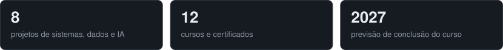
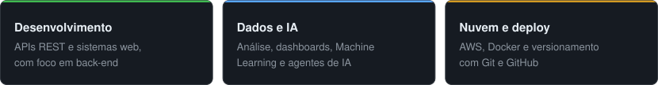
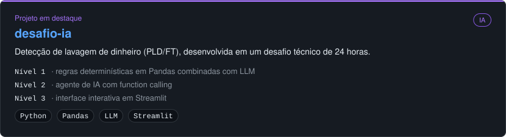
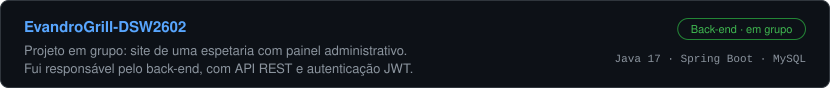
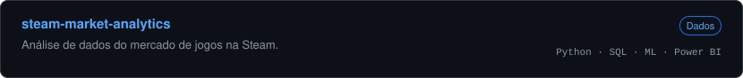
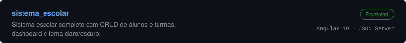
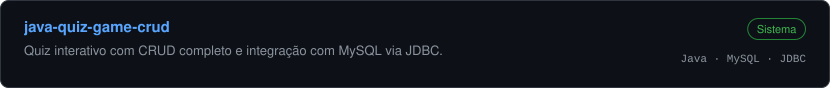

## `> sobre`

### Construo sistemas e analiso dados.

Sou o Mateus, estudante de **Análise e Desenvolvimento de Sistemas no Senac**, em São Paulo. Aprendo colocando a mão na massa, do back-end ao dashboard.

`[+]` Buscando meu **primeiro estágio** em TI, Dados ou Desenvolvimento  
`[+]` Formação prevista para dezembro de 2027

## `> areas`

## `> ferramentas`

## `> projetos`

Veja também:
[academia-sql](https://github.com/Matssc/academia-sql) ·
[iris-segmentation-kmeans](https://github.com/Matssc/iris-segmentation-kmeans) ·
[analise-vendas-python](https://github.com/Matssc/analise-vendas-python)

## `> aprendendo`

`[~]` Spring Boot e Angular na faculdade  
`[~]` AWS para dados: Glue, Athena e QuickSight
